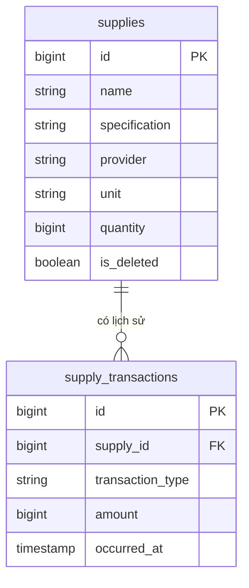

# Session12 - Quản lý vật tư y tế

Spring Boot, Java 21, PostgreSQL, JPA, Lombok/SLF4J. Đủ 9 chức năng trong cùng project.

## Chạy ứng dụng

1. Mở project trong IntelliJ, chọn JDK 21, tải lại Gradle.
2. Chạy `BaitapSession12Application`, Working directory là thư mục project `baitapSession12`.
3. Dùng Postman gọi các URL bên dưới; Body chọn raw → JSON.

Database `medical_supplies_session12` đã được chuẩn bị trên máy hiện tại. Mật khẩu nằm ngoài project tại `../.local-config/baitapSession12.properties`. Máy khác tạo database bằng `CREATE DATABASE medical_supplies_session12;`, đặt DB_USERNAME/DB_PASSWORD; DB_URL cho phép đổi địa chỉ kết nối. Hibernate tự tạo bảng.

## Thiết kế dữ liệu



Giao dịch có type IMPORT/EXPORT; amount luôn dương. Xóa vật tư chỉ đổi is_deleted, giữ nguyên bản ghi và lịch sử giao dịch.

## API

Tiền tố chung: `http://localhost:8080/api/v1/supplies`.

| Chức năng | Method | URL |
| --- | --- | --- |
| Thêm vật tư | POST | `/api/v1/supplies` |
| Sửa thông tin | PUT | `/api/v1/supplies/{id}` |
| Xóa mềm | DELETE | `/api/v1/supplies/{id}` |
| Danh sách đang hoạt động | GET | `/api/v1/supplies` |
| Tìm theo tên gần đúng | GET | `/api/v1/supplies/search?name=khẩu` |
| Xuất kho | PATCH | `/api/v1/supplies/{id}/export` |
| Nhập kho | PATCH | `/api/v1/supplies/{id}/import` |
| Xuất kho trong ngày | GET | `/api/v1/supplies/statistics/daily-export` |
| Xuất kho nhiều nhất | GET | `/api/v1/supplies/statistics/top-export` |

### Tạo vật tư

```json
{
  "name": "Khẩu trang y tế",
  "provider": "Medical VN",
  "unit": "Hộp",
  "specification": "50 chiếc/hộp",
  "quantity": 999
}
```

Trả **201**, quantity vẫn bằng **0** bất kể client gửi gì; id và isDeleted cũng do server quyết định. name/provider/unit bắt buộc. Lưu id trả về để thử các API tiếp theo.

### Cập nhật thông tin

PUT theo id với đúng các trường sau:

```json
{
  "name": "Khẩu trang y tế 4 lớp",
  "specification": "50 chiếc/hộp",
  "provider": "Medical VN"
}
```

Chỉ ba trường trên được phép. Gửi id, quantity hoặc trường khác trả **400**, kể cả giá trị null, đồng thời ghi WARN và ERROR/stack trace. Tồn kho và đơn vị tính không thay đổi.

### Nhập/xuất kho

Cả hai API PATCH nhận:

```json
{"amount": 10}
```

amount là số nguyên dương, bắt buộc. Ví dụ: nhập 10 rồi xuất 4 → tồn 6 và có hai giao dịch trong DB. Xuất 7 tiếp theo trả **400**, message `Số lượng tồn kho không đủ để xuất`; tồn và lịch sử giữ nguyên. Tràn giới hạn số nguyên khi nhập cũng trả 400.

Nhập/xuất dùng @Transactional, khóa PESSIMISTIC_WRITE theo vật tư để tránh mất cập nhật hoặc tồn âm khi có request đồng thời. Mỗi giao dịch và cập nhật tồn được commit cùng nhau. history.log chỉ ghi sau khi nhập kho commit thành công.

### Xóa mềm, danh sách và tìm kiếm

DELETE thành công trả **204 No Content**, body rỗng theo chuẩn HTTP. Đây là ngoại lệ duy nhất của wrapper; lỗi DELETE vẫn trả ApiResponse. ID không tồn tại/đã xóa trả **404**. PUT/nhập/xuất với vật tư đã xóa cũng trả 404.

Danh sách/tìm kiếm chỉ lấy isDeleted=false. Tìm kiếm dùng LIKE thông qua Spring Data JPA, không phân biệt hoa/thường; không có kết quả trả **200** với data=[] và ghi INFO theo yêu cầu. name là query param bắt buộc.

### Thống kê

- Daily-export trả mảng `{supplyId, supplyName, totalExportQuantity}`. Tính từ các giao dịch EXPORT có occurredAt từ 00:00 hôm nay (bao gồm) đến 00:00 ngày mai (không bao gồm), theo ngày của máy chạy ứng dụng. Không có xuất kho hôm nay thì data=[].
- Top-export trả một object `{supplyId, topSupplyName, totalExportQuantity}` dựa trên tổng EXPORT toàn bộ lịch sử. Nếu hòa, lấy vật tư có ID nhỏ hơn. Chưa có EXPORT trả **404**, message `Chưa có dữ liệu giao dịch để thống kê`.
- Số liệu lịch sử vẫn bao gồm vật tư đã xóa mềm để phục vụ đối soát. IMPORT không được cộng vào thống kê xuất kho.

## Phản hồi và logging

ApiResponse thống nhất: `{status, message, data}`, status là SUCCESS/FAIL. Thành công thông thường trả 200; tạo mới 201; DELETE thành công 204 rỗng; lỗi dữ liệu/nghiệp vụ 400, không tìm thấy 404, lỗi hệ thống 500. Validation trả map lỗi trong data, các lỗi khác data=null. Client không nhận stack trace.

- `logs/medical_supplies.log`: INFO mỗi hành động, DEBUG số bản ghi và ERROR kèm stack trace cho mọi lỗi. Thiếu tồn có dòng ERROR chi tiết ID, số lượng yêu cầu và tồn hiện tại.
- `logs/history.log`: logger riêng cho nhập kho, mẫu `Nhập kho ID 1, số lượng +10, tồn cũ 0`.
- Logback xoay file ở ngưỡng 2MB, nén .gz theo ngày, giữ lịch sử 7 ngày.

## Kiểm tra DB

```sql
SELECT id, name, provider, unit, quantity, is_deleted FROM supplies ORDER BY id;
SELECT id, supply_id, transaction_type, amount, occurred_at FROM supply_transactions ORDER BY id;
```

Build/cache và mật khẩu được đặt ngoài project khi kiểm tra. Khi kéo thả GitHub, bỏ logs/, build/, .gradle/, .idea/ nếu có để giữ ít file nộp.
